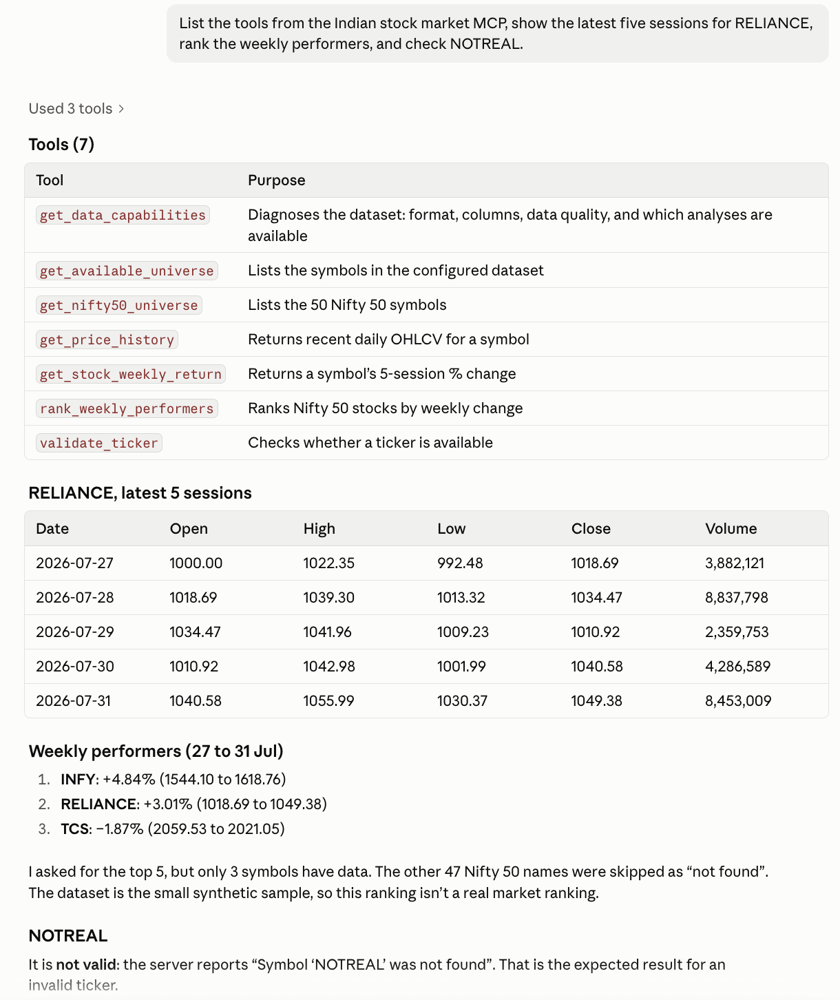

# Indian Stock Market MCP

[](https://github.com/ratan-systems/indian-stock-market-mcp/actions/workflows/ci.yml)

A local, MCP-first server for Indian equity research with daily OHLCV data.
It works with Codex, Claude Code, Cursor, and other MCP-compatible clients.

The server does not call OpenAI or Anthropic APIs and does not require either
provider's API key. Your MCP client supplies the model; this project supplies
the market-data tools.

> [!WARNING]
> This is a research and demonstration tool, not investment advice. Verify data
> quality, corporate-action treatment, and price-adjustment status before using
> results for investment decisions or production backtests.

## Demo



The MCP client discovers the available research tools, returns RELIANCE price
history, ranks weekly performers, and handles an unavailable ticker.

## What It Does

- Reads a local `.parquet` or `.csv` daily-equity dataset.
- Returns recent price history for one ticker.
- Validates whether a ticker exists in the configured dataset.
- Calculates five-session close-to-close performance for one ticker.
- Ranks weekly performers from a bundled index universe (Nifty 50 by default).
- Lists all symbols in the configured dataset or the bundled Nifty 50 list, and lists the bundled index universes.
- Diagnoses the configured dataset: readability, schema, counts, date range,
  data-quality problems, available analyses, and warnings.

The current 0.x scope is deliberately small: local historical data,
research-oriented tools, and a quick MCP demo. It does not provide live prices,
fundamentals, news, order execution, or portfolio management.

### v0.1.1 Scope

v0.1.1 hardens the public foundation rather than adding research features. It
tightens dataset validation and error handling, ships the Nifty 50 list inside
the package, finalizes tool names and descriptions, adds dataset diagnostics,
and adds MCP-level tests. See the [changelog](CHANGELOG.md).

### Migrating from v0.1.0

Two tools were renamed in v0.1.1. Arguments and response shapes are
unchanged, so only the tool name needs updating in prompts, scripts, and
client configuration. The old names were removed without a deprecation
period; this is a 0.x project, so tool contracts may still change between
releases (see the note under [Tools](#tools)).

| v0.1.0 tool | v0.1.1 tool | Notes |
| --- | --- | --- |
| `get_weekly_performance_summary` | `rank_weekly_performers` | Same `top_n` argument (default 5) and the same `top_n`, `rankings`, and `skipped` response |
| `get_weekly_performance` | `get_stock_weekly_return` | Same `symbol` argument and the same five-session return response |

Calling an old name now fails with an "Unknown tool" error.

## Quick Start

Requirements: Python 3.11 or newer (3.11, 3.12, and 3.13 are declared as
supported).

### Install a release

Releases are published on GitHub, not PyPI. Install the release wheel into a
virtual environment (use the version you want in place of `0.1.1`):

```bash
python -m venv .venv
source .venv/bin/activate
python -m pip install https://github.com/ratan-systems/indian-stock-market-mcp/releases/download/v0.1.1/indian_stock_market_mcp-0.1.1-py3-none-any.whl
```

Each release also lists a `SHA256SUMS` file for verifying the downloads. The
wheel does not include the sample data, so download it to try the server:

```bash
curl -LO https://raw.githubusercontent.com/ratan-systems/indian-stock-market-mcp/v0.1.1/data/sample_equity_daily.csv
export INDIAN_STOCK_DATA_PATH="$(pwd)/sample_equity_daily.csv"
indian-stock-market-mcp
```

### Install from source (for development)

```bash
git clone https://github.com/ratan-systems/indian-stock-market-mcp.git
cd indian-stock-market-mcp

python -m venv .venv
source .venv/bin/activate
python -m pip install -e ".[dev]"
```

Configure the dataset path. The public sample is enough to try the server:

```bash
export INDIAN_STOCK_DATA_PATH="$(pwd)/data/sample_equity_daily.csv"
indian-stock-market-mcp
```

For normal MCP use, set `INDIAN_STOCK_DATA_PATH` in your client configuration
instead of starting the server manually. See the examples below.

## MCP Client Configuration

Ready-to-copy configuration files are in [`examples/`](examples/):

- Codex: [`examples/codex-config.toml`](examples/codex-config.toml)
- Claude Code: [`examples/claude-code.mcp.json`](examples/claude-code.mcp.json)
- Cursor: [`examples/cursor-mcp.json`](examples/cursor-mcp.json)
- Prompts, responses, and a complete workflow: [`examples/README.md`](examples/README.md)

In both files, replace the two placeholder paths:

1. The executable: `.../.venv/bin/indian-stock-market-mcp`
2. The data file: a local `.parquet` or `.csv` path

Any stdio MCP client can use the same command and environment variable. For
Cursor or another client, add a server named `indian-stock-market`, use the
installed executable as its command, and set `INDIAN_STOCK_DATA_PATH` in its
environment section.

## Data Format

The server accepts `.parquet` and `.csv` files. Column names are lowercase.

| Column | Required | Meaning |
| --- | --- | --- |
| `date` | Yes | Trading date; parseable as a date, preferably `YYYY-MM-DD` |
| `symbol` | Yes | Equity ticker; whitespace and case are normalized |
| `open` | Yes | Daily opening price |
| `high` | Yes | Daily high price |
| `low` | Yes | Daily low price |
| `close` | Yes | Daily closing price |
| `volume` | No | Daily traded volume; returned as null when unavailable |

Each symbol must have unique dates. The server sorts records by date before
returning price history or calculating performance.

The repository includes [`data/sample_equity_daily.csv`](data/sample_equity_daily.csv),
a **synthetic** dataset of five sessions each for `RELIANCE`, `TCS`, and
`INFY`. The prices are generated, not real market data; see
[`data/README.md`](data/README.md) for how it is produced.
Because this is a three-symbol sample, Nifty 50 rankings will return those
available symbols and list the remaining constituents in `skipped`. This is
expected; use a broader dataset for a complete ranking.

## Importing NSE and BSE Bhavcopy Files

A *bhavcopy* is the exchange's end-of-day price file for every security traded
that day. The `import-bhavcopy` command merges a folder of daily files into one
Parquet file in the format above, which you can point the server at.

### Where to download

| Exchange | Where | File name |
| --- | --- | --- |
| NSE | Daily reports on [nseindia.com](https://www.nseindia.com/all-reports) (Capital Market, "Bhavcopy"), or `nsearchives.nseindia.com/content/cm/` | `BhavCopy_NSE_CM_0_0_0_YYYYMMDD_F_0000.csv.zip` |
| BSE | [Bhav Copy page](https://www.bseindia.com/markets/MarketInfo/BhavCopy.aspx) on bseindia.com, or `bseindia.com/download/BhavCopy/Equity/` | `BhavCopy_BSE_CM_0_0_0_YYYYMMDD_F_0000.CSV` |

The exchanges sometimes refuse scripted downloads. If a script is blocked,
download the files in a browser. Check the exchange's terms before using or
redistributing the data.

### Supported formats

Only the **current common layout** that both exchanges publish (named
`BhavCopy_<EXCHANGE>_CM_...`) is supported, as a `.csv` or a `.csv.zip`. The
older exchange-specific layouts are not supported.

### Import

Put the daily files for **one exchange** in one folder, then run:

```bash
indian-stock-market-mcp import-bhavcopy path/to/folder --output nse.parquet
```

Then set `INDIAN_STOCK_DATA_PATH` to the new file. The command:

- reads the files directly in the folder (sub-folders are not searched) and
  ignores any that are not named `BhavCopy_*.csv` or `.zip`;
- merges them in date order;
- skips dates already in the output, so re-running adds only new days;
- writes nothing unless every file reads cleanly and the merged data would
  load in the server;
- prints a summary: files read, skipped and ignored, rows read, kept and
  dropped, date range, and symbol count.

The default output is `bhavcopy.parquet` in the current folder. Running the
command with no arguments still starts the MCP server.

### What is kept

| Exchange | Series kept | Notes |
| --- | --- | --- |
| NSE | `EQ`, `BE` | Symbol is NSE's ticker |
| BSE | groups `A`, `B`, `T`, `X`, `XT` | Nifty 50 stocks use their NSE symbol through the bundled scrip-code mapping; every other stock keeps BSE's own ticker, which can differ from its NSE symbol |

Everything else is dropped and counted in the summary: government securities,
bonds, SME listings, trusts, and BSE group `Z` (companies with compliance
problems).

Things to know:

- **ETFs are kept.** They trade in the same series as company shares, so
  `get_available_universe` will list them.
- **One exchange per output file.** NSE and BSE rows for the same stock would
  collide, so the command refuses to mix them or to extend a file created for
  the other exchange. Use two output files.
- **Prices are stored exactly as published.** Bhavcopy prices are not adjusted
  for splits, bonuses or dividends. After importing, the command checks large
  price falls and saves adjustment factors beside the file (see
  [Split and Bonus Adjustment](#split-and-bonus-adjustment)). Dividends are
  never adjusted.
- Group letters were checked against secondary sources and the exchange's own
  files, not an official BSE definition page.

## Split and Bonus Adjustment

When a stock splits or issues bonus shares its price drops overnight, and
nothing in the bhavcopy file says why. Left alone, that looks like a crash, a
fake 52-week high or a huge drawdown. The exchange's own "previous close"
column is not adjusted either, so it cannot be used to detect these events.

`import-bhavcopy` therefore runs a check after every import, and
`refresh-adjustments` runs it on its own:

```bash
uv run indian-stock-market-mcp import-bhavcopy ./bhavcopy --output nse.parquet
uv run indian-stock-market-mcp refresh-adjustments nse.parquet
uv run indian-stock-market-mcp import-bhavcopy ./bhavcopy --output nse.parquet --no-adjust
```

How it works:

1. **Find large falls.** Every close at least 15% below the stock's previous
   close is a candidate. That catches every split and every bonus down to 1:5.
2. **Ask Yahoo.** [yfinance](https://github.com/ranaroussi/yfinance) supplies
   Yahoo's closes for the day before and the day of each candidate. Yahoo's
   prices are adjusted for splits and bonuses, so our close divided by Yahoo's
   close is a constant before the event and a different constant after it. The
   ratio of the two is the factor. For Bajaj Finance on 16 June 2025,
   9331 / 933.1 = 10 before and 938 / 938 = 1 after, so the factor is 10.
   Yahoo's own list of splits is not used, because it misses events (it lists
   Bajaj Finance's 4:1 bonus and 1:2 split as a single 2).
3. **Accept clean ratios only.** The factor must be a whole split ratio (2 to
   100) or an a:b bonus ratio with a and b up to 5, such as 1.5 for a 1:2
   bonus. A fall where both our price and Yahoo's fell together is a real
   crash and needs no adjustment. Anything else is saved as unverified.

The answers are saved in `<file>.adjustments.json` beside the Parquet file.
Each day is checked once, and unverified days are retried on the next import or
refresh, so the server itself never needs the internet. Prices before each
event are divided by its factor and volume is multiplied by it, so history
reads as if the split had always been in place.

Which tools use adjusted prices:

| Adjusted | As published |
| --- | --- |
| `get_stock_weekly_return`, `rank_weekly_performers`, `get_stock_indicators` | `get_price_history`, `get_data_quality_report` |

Warnings tell you where adjustment is missing: `unadjusted_prices` for an
imported file that was never checked, and `price_adjustment_unknown` for large
falls Yahoo could not confirm (naming the stock and date), or when the answers
file is damaged. `get_data_capabilities` reports the status, the number of
adjusted events and the number of unverified days under `price_adjustment`. A
CSV or any file not created by `import-bhavcopy` is never adjusted, because it
may already be.

Limits to know about:

- A bonus smaller than 1:5 (a price fall under 15%) is not detected. Reverse
  splits (price rises) are not handled.
- Yahoo is an unofficial source and its data may be wrong or missing for some
  stocks, which is why unverified days are reported instead of guessed.
- Yahoo's terms allow personal use. Each user's own server fetches the data
  for their own files. To re-check the method against live Yahoo data, run
  `uv run python scripts/check_adjustments.py`.

## Tools

> [!NOTE]
> This is a 0.x project (currently v0.1.1). Tool names, parameters, and
> response shapes may still change between 0.x releases. Breaking changes are
> called out in the [changelog](CHANGELOG.md).

| Tool | Inputs | Returns |
| --- | --- | --- |
| `get_price_history` | `symbol`, optional `sessions` (1-100; default 5) | Recent date-sorted OHLCV records |
| `validate_ticker` | `symbol` | Availability flag, normalized ticker, and message |
| `get_stock_weekly_return` | `symbol` | Five-session close-to-close return for one ticker |
| `rank_weekly_performers` | optional `top_n` (1-50; default 5), optional `universe` (default `NIFTY_50`) | Top N performers of a [universe](#universes) or [watchlist](#watchlists) plus skipped symbols |
| `get_available_universe` | None | Normalized symbols in the configured dataset |
| `get_nifty50_universe` | None | Normalized symbols in the bundled Nifty 50 list |
| `list_universes` | None | The bundled index [universes](#universes) with symbol counts and as-of dates |
| `create_watchlist` | `name`, `symbols` | Saves a new [watchlist](#watchlists) |
| `get_watchlists` | optional `name` | One saved watchlist, or all of them |
| `update_watchlist` | `name`, optional `add_symbols`, `remove_symbols`, `new_name` | Adds or removes symbols, or renames |
| `delete_watchlist` | `name` | Permanently deletes a watchlist |
| `get_data_capabilities` | None | Health report for the configured dataset (see [Dataset Diagnostics](#dataset-diagnostics)) |
| `get_data_quality_report` | optional `jump_threshold_percent` (default 25), `min_history_sessions` (default 5), `stale_after_sessions` (default 10) | Whether the dataset can be trusted for research, with reasons (see [Data Quality Report](#data-quality-report)) |
| `get_stock_indicators` | `symbol`, optional `ema_periods`, `rsi_period`, `atr_period`, `traded_value_sessions` | EMAs, RSI, ATR and average traded value for one stock (see [Indicators and Settings](#indicators-and-settings)) |
| `get_indicator_settings` | None | The saved indicator settings, the defaults, and which settings were customised |
| `update_indicator_settings` | `changes` (for example `{"rsi_period": 21}`) | Saves new defaults for the analysis tools |
| `reset_indicator_settings` | optional `names` | Restores the named settings, or all of them, to the defaults |

### Symbol Input

Every tool that takes a `symbol` accepts the common ways of writing it and
cleans it to one canonical symbol: `tcs`, ` TCS `, `TCS.NS`, `TCS.BO`,
`NSE:TCS` and `BSE:TCS` all mean `TCS`. Symbols such as `M&M`, `BAJAJ-AUTO` and
`BSE` are kept as they are. The cleaned symbol appears in the response's
`parameters`.

The cleanup does not change which prices you get: the dataset does not record
the exchange, so `TCS.BO` returns the same data as `TCS.NS`.

A BSE scrip code in the bundled Nifty 50 mapping is translated to its NSE
symbol: `500325`, `500325.BO` and `BSE:500325` all mean `RELIANCE`. A number
that is not in the mapping is kept as it is and treated as an unknown symbol.

### Example Requests

Ask an MCP client:

```text
Show the latest five sessions for RELIANCE.
```

```text
What was INFY's five-session performance?
```

```text
Show the top five Nifty 50 weekly performers and any skipped symbols.
```

`get_price_history` returns JSON-safe records inside the standard
[response envelope](#response-envelope):

```json
{
  "envelope_version": 1,
  "data": {
    "symbol": "RELIANCE",
    "session_returned": 5,
    "prices": [
      {
        "date": "2026-07-20",
        "symbol": "RELIANCE",
        "open": 1317.2,
        "high": 1345.9,
        "low": 1314.9,
        "close": 1323.1,
        "volume": 14305844
      }
    ]
  },
  "source": {"kind": "dataset", "file_name": "prices.parquet", "format": "parquet"},
  "as_of": "2026-07-20",
  "parameters": {"symbol": "RELIANCE", "sessions": 5},
  "warnings": []
}
```

### Response Envelope

Every tool wraps its result in the same envelope:

| Field | Meaning |
| --- | --- |
| `envelope_version` | Version of the envelope format (currently `1`) |
| `data` | The tool's result |
| `source` | Where the data came from: `kind` (`dataset` or `bundled`), `file_name` and `format`. The full file path is never returned |
| `as_of` | Latest market date (`YYYY-MM-DD`) the answer reflects. For `get_nifty50_universe` it is the list's own as-of date, and it is `null` when there is no single date (`list_universes`) |
| `parameters` | The inputs as the server understood them, after normalization (for example, `" tcs "` becomes `"TCS"`) |
| `warnings` | Caveats about the result, each `{code, message}` plus an optional `symbols` list |

Warnings do not mean the call failed. Calls that cannot produce an answer, such
as `get_price_history` for an unknown symbol, still fail as MCP errors.

| Warning code | Meaning |
| --- | --- |
| `symbol_not_found` | A requested or ranked symbol is not in the dataset |
| `short_history` | Fewer sessions were available than the request needed, or than the minimum history |
| `duplicate_rows` | The same symbol and date appears more than once |
| `impossible_prices` | Rows with missing, non-positive or inconsistent prices |
| `invalid_rows` | Rows with a missing symbol or an invalid date |
| `large_price_move` | One-day moves beyond the jump threshold, often unadjusted splits or bonuses |
| `missing_trading_days` | Trading days with no row inside a symbol's own history |
| `no_usable_data` | No row could be used for the quality checks |
| `universe_outdated` | A universe list is older than 180 days |
| `universe_symbols_missing` | A universe has symbols the dataset does not contain |
| `symbols_unchecked` | Symbols could not be checked because no dataset could be read |
| `insufficient_sessions` | Dataset diagnostics: symbols with too few sessions for weekly returns |
| `price_adjustment_unknown` | Split and dividend adjustment status cannot be determined |
| `unadjusted_prices` | Prices are known not to be adjusted for splits or dividends |
| `stale_data` | Symbols whose data stops well before the dataset's last date |
| `illiquid` | Trading volume is too low for the result to be reliable |
| `volume_column_missing` | The dataset has no volume column |
| `volume_all_missing` | The volume column has no values |

`unadjusted_prices` and `illiquid` are reserved: they are registered but no
tool emits them yet.

## Universes

A *universe* is a named list of stocks that a tool can work on. Twelve are
bundled, built from the constituent lists NSE Indices publishes:

| Universe id | Index | Symbols |
| --- | --- | --- |
| `NIFTY_50` | Nifty 50 | 50 |
| `NIFTY_NEXT_50` | Nifty Next 50 | 50 |
| `NIFTY_100` | Nifty 100 | 100 |
| `NIFTY_200` | Nifty 200 | 200 |
| `NIFTY_500` | Nifty 500 | about 500 |
| `NIFTY_BANK` | Nifty Bank (Bank Nifty) | 14 |
| `NIFTY_IT`, `NIFTY_PHARMA`, `NIFTY_AUTO`, `NIFTY_FMCG`, `NIFTY_METAL`, `NIFTY_ENERGY` | Sector indices | 10 to 40 each |

`rank_weekly_performers` takes a universe, for example
`rank_weekly_performers(universe="nifty bank")`. Names are forgiving: `NIFTY_500`,
`nifty 500`, `Nifty-500` and `NIFTY500` all work, and so does `BANKNIFTY`.
Without the argument it ranks the Nifty 50, as before. `list_universes` shows
every universe with its symbol count and as-of date.

- **As-of date.** NSE's list files carry no date, so each universe's as-of date
  is the day the lists were downloaded, not the day NSE last changed the index.
- **Old lists.** Index membership changes about twice a year, so a list older
  than 180 days gets a `universe_outdated` warning.
- **Symbols missing from your data.** `list_universes` reports, for each
  universe, how many symbols your dataset does not contain, and warns with
  `universe_symbols_missing`. A ranking skips symbols the dataset lacks and
  lists them in `skipped`.
- **Refreshing the lists.** Download the constituent CSVs from NSE Indices
  (for example `ind_nifty500list.csv`) into a folder and run
  `python scripts/build_universes.py --input FOLDER`. It rewrites
  `src/indian_stock_market_mcp/resources/universes.json`. Check NSE Indices'
  terms before redistributing the lists.

## Watchlists

A *watchlist* is your own named list of symbols, saved so you can use it by
name. Save `my_banks` once, then ask for
`rank_weekly_performers(universe="my_banks")`. Anywhere a bundled
[universe](#universes) name is accepted, a watchlist name is too.

- `create_watchlist(name, symbols)` saves a list. Every symbol is cleaned (for
  example `tcs.ns` becomes `TCS`) and repeats are dropped.
- `get_watchlists()` shows all watchlists; `get_watchlists(name)` shows one.
- `update_watchlist(name, add_symbols, remove_symbols, new_name)` changes one in
  a single call. A watchlist cannot be emptied; delete it instead.
- `delete_watchlist(name)` removes it for good.

Rules:

- **Names** are 1 to 40 characters (letters, digits, spaces, `-` and `_`) and
  are found whatever their capitalisation or spelling: `My Banks`, `my-banks`
  and `MY_BANKS` are the same watchlist.
- **Universe names are reserved.** A watchlist cannot be called `NIFTY_50`,
  `nifty 500` or `BANKNIFTY`, so a name always means one thing.
- **Symbols not in your dataset are still saved.** They are reported in a
  `symbol_not_found` warning, so a typo shows up at once. If no dataset can be
  read, the symbols are saved and a `symbols_unchecked` warning says so.
- **Limits:** 100 watchlists, 1000 symbols each.

Watchlists are the one thing this server writes to your computer. They live in
a small JSON file, by default `~/.indian-stock-market-mcp/watchlists.json`. Set
`INDIAN_STOCK_WATCHLIST_PATH` in your client configuration to keep the file
somewhere else. A file the server cannot read is reported and left untouched,
and a save writes a new file in one step, so a failure cannot leave a half-written
file. The response never shows the file's full path.

## Data Quality Report

`get_data_quality_report` answers a harder question than `get_data_capabilities`:
not "can the file be read?" but "can the prices be trusted for research and
backtesting?" It scans every symbol, so it is slower on a large file. It does
not stop at bad values; it counts and lists them.

| Check | What it finds |
| --- | --- |
| Duplicate rows | The same symbol and date more than once |
| Impossible prices | Missing, zero or negative prices; a high below the low; an open or close outside the high-low range |
| Large one-day moves | A close more than `jump_threshold_percent` (default 25%) away from the previous trading day's close, which often means an unadjusted split or bonus |
| Missing trading days | Trading days with no row, counted between each symbol's own first and last date |
| Stale symbols | Symbols with no data for more than `stale_after_sessions` (default 10) trading days before the dataset's last date |
| History length | Sessions, first date and last date for each symbol (the shortest 50 are listed) |

The result's `backtest_ready` is `true` only when nothing **blocking** was found.

| Finding | Blocks the verdict? |
| --- | --- |
| Invalid rows (missing symbol or date), duplicate rows, impossible prices | Yes |
| Large one-day moves | Yes: possible unadjusted splits or bonuses distort returns |
| No symbol has `min_history_sessions` (default 5) sessions | Yes |
| Some symbols have a short history, are stale, or have missing days | No: listed as notes so those symbols can be excluded |

Every finding also appears in the envelope's `warnings`, with the symbols
affected. Notes:

- **The trading calendar is inferred** from the data: a date is a trading day
  when a typical share of the usual daily rows is present. A day missing for
  every symbol cannot be detected.
- **Bhavcopy prices are unadjusted**, so splits and bonuses in imported data
  appear as large moves. The 25% default catches large ones (such as a 1:1
  bonus or a 1:2 split) but not small ones (such as a 1:4 bonus, a 20% fall),
  which look like an ordinary circuit-limit day.
- **A flagged move is a prompt to look, not a proof.** Large moves can be real,
  for example on the first day of an IPO.

## Indicators and Settings

`get_stock_indicators` returns the latest technical indicators for one stock,
calculated from its full history in the dataset:

| Field | Meaning |
| --- | --- |
| `ema` | Exponential moving average for each period, and how far the close is above or below it (`close_vs_ema_percent`) |
| `rsi` | Relative Strength Index (0 to 100) with Wilder smoothing |
| `atr` | Average True Range in rupees and as a percent of the close |
| `average_traded_value` | Average of close x volume over the last N sessions, in rupees and crore |

The formulas come from [TA-Lib](https://ta-lib.org/), the standard indicator
library, so the numbers match other charting tools. An EMA needs as many
sessions as its period, and RSI and ATR need one more (their 14-day versions
need 15). RSI is 100 when a stock had no down days in the window and 50 when
the price did not move.

An indicator that needs more history than the stock has is `null`, and one
`short_history` warning names what is missing. A stock whose average traded
value is below the illiquid limit gets an `illiquid` warning, and a dataset
without volume gets `volume_all_missing`.

The periods come from your saved settings. They can be changed with
`update_indicator_settings`, so you or your AI assistant can adjust them in
conversation, and any tool argument overrides a setting for that one question
without saving it.

| Setting | Default | Allowed |
| --- | --- | --- |
| `ema_periods` | `[20, 50, 200]` | 1 to 5 periods, each 2 to 400 |
| `rsi_period` | `14` | 2 to 100 |
| `atr_period` | `14` | 2 to 100 |
| `traded_value_sessions` | `20` | 5 to 250 |
| `illiquid_below_crore` | `1.0` | 0 to 1000 (rupees crore a day) |
| `year_sessions` | `252` | 200 to 260 |
| `near_high_percent` | `5.0` | 0.5 to 50 |
| `relative_strength_periods` | `{"1m": 21, "3m": 63, "6m": 126}` | 1 to 6 periods, each 5 to 504 sessions |
| `default_benchmarks` | `["NIFTY_50", "auto_size", "auto_sector"]` | 1 to 5 universe or watchlist names, or `auto_size` / `auto_sector` |

Settings are kept in `~/.indian-stock-market-mcp/indicator_settings.json`, or
the path in `INDIAN_STOCK_SETTINGS_PATH`. Only values you changed are stored,
so a default improved in a later version still reaches you. A damaged file is
reported and never overwritten.

## Dataset Diagnostics

> [!NOTE]
> `get_data_capabilities` returns the report below as the envelope's `data`,
> with two changes: the `source` block is named `dataset`, and `warnings` is
> the envelope's own `warnings` field.

`get_data_capabilities` tells you whether the configured dataset is usable
before you run any analysis. It never raises: a missing or broken dataset is
reported as a result, not an error. Unlike the other tools, which stop at the
first problem, it collects every problem in one pass and counts the affected
rows.

| Status | Meaning |
| --- | --- |
| `healthy` | No errors; the only warning is the standing price-adjustment notice |
| `incomplete` | Usable, but some analysis is unavailable (for example no volume, or symbols with too few sessions) |
| `invalid` | Not usable; at least one error. All `capabilities` are `false` |

Response fields:

| Field | Contents |
| --- | --- |
| `status` | `healthy`, `incomplete`, or `invalid` |
| `source` | `configured`, `available`, `readable`, `file_name`, `format` |
| `schema` | `columns`, `required_columns`, `missing_required_columns`, `optional_columns_present` |
| `summary` | `row_count`, `symbol_count`, `date_range` (`start`/`end`); `null` values when unknown |
| `capabilities` | `price_history`, `weekly_return`, `volume_analysis` |
| `data_quality` | `issue_counts` (rows per problem type) and `symbols_with_insufficient_sessions` (`count` plus up to 20 `symbols`) |
| `errors` | Problems that make the dataset unusable, each with a `code` and `message` |
| `warnings` | Limitations that do not block use, each with a `code` and `message` |

Error codes: `dataset_not_configured`, `file_not_found`, `unsupported_format`,
`unreadable_file`, `missing_required_columns`, `data_load_failed`, and one per
`issue_counts` key (`empty_dataset`, `invalid_symbol`, `invalid_date`,
`duplicate_symbol_date`, `invalid_ohlc_price`, `non_finite_ohlc_price`,
`non_positive_ohlc_price`, `inconsistent_ohlc`, `non_numeric_volume`,
`non_finite_volume`, `negative_volume`).

Warning codes: `price_adjustment_unknown` (always present),
`volume_column_missing`, `volume_all_missing`, `insufficient_sessions`.

A symbol needs at least five sessions for a weekly return; symbols with fewer
are listed in `symbols_with_insufficient_sessions`. The data carries no
adjustment metadata, so `price_adjustment_unknown` is always reported.

> [!NOTE]
> Responses include only the data file's name, never its full path, and
> read failures report only the error type.

### Healthy

A complete dataset with volume and enough sessions:

```json
{
  "status": "healthy",
  "source": {
    "configured": true,
    "available": true,
    "readable": true,
    "file_name": "healthy.csv",
    "format": "csv"
  },
  "schema": {
    "columns": ["date", "symbol", "open", "high", "low", "close", "volume"],
    "required_columns": ["date", "symbol", "open", "high", "low", "close"],
    "missing_required_columns": [],
    "optional_columns_present": ["volume"]
  },
  "summary": {
    "row_count": 10,
    "symbol_count": 2,
    "date_range": { "start": "2026-07-27", "end": "2026-07-31" }
  },
  "capabilities": {
    "price_history": true,
    "weekly_return": true,
    "volume_analysis": true
  },
  "data_quality": {
    "issue_counts": {
      "empty_dataset": 0,
      "invalid_symbol": 0,
      "invalid_date": 0,
      "duplicate_symbol_date": 0,
      "invalid_ohlc_price": 0,
      "non_finite_ohlc_price": 0,
      "non_positive_ohlc_price": 0,
      "inconsistent_ohlc": 0,
      "non_numeric_volume": 0,
      "non_finite_volume": 0,
      "negative_volume": 0
    },
    "symbols_with_insufficient_sessions": { "count": 0, "symbols": [] }
  },
  "errors": [],
  "warnings": [
    {
      "code": "price_adjustment_unknown",
      "message": "Price-adjustment status for splits and dividends is unknown; verify it before relying on returns."
    }
  ]
}
```

The bundled `data/sample_equity_daily.csv` also reports `healthy`.

### Incomplete

No `volume` column, and `INFY` has only two sessions. The dataset works, but
volume analysis is unavailable and `INFY` is excluded from weekly returns.
Unchanged sections (`source`, `schema`, and zero-valued `issue_counts`) are
trimmed here and in the next example:

```json
{
  "status": "incomplete",
  "summary": {
    "row_count": 12,
    "symbol_count": 3,
    "date_range": { "start": "2026-07-27", "end": "2026-07-31" }
  },
  "capabilities": {
    "price_history": true,
    "weekly_return": true,
    "volume_analysis": false
  },
  "data_quality": {
    "symbols_with_insufficient_sessions": { "count": 1, "symbols": ["INFY"] }
  },
  "errors": [],
  "warnings": [
    {
      "code": "price_adjustment_unknown",
      "message": "Price-adjustment status for splits and dividends is unknown; verify it before relying on returns."
    },
    {
      "code": "volume_column_missing",
      "message": "No volume column; volume-based analysis is unavailable."
    },
    {
      "code": "insufficient_sessions",
      "message": "1 symbol(s) have fewer than 5 sessions and are excluded from weekly return calculations."
    }
  ]
}
```

### Invalid

One bad date, one duplicate symbol-date record, and two rows with impossible
prices. All problems are reported together, and every capability is `false`:

```json
{
  "status": "invalid",
  "summary": {
    "row_count": 13,
    "symbol_count": 3,
    "date_range": { "start": "2026-07-27", "end": "2026-07-31" }
  },
  "capabilities": {
    "price_history": false,
    "weekly_return": false,
    "volume_analysis": false
  },
  "data_quality": {
    "issue_counts": {
      "invalid_date": 1,
      "duplicate_symbol_date": 1,
      "inconsistent_ohlc": 2
    }
  },
  "errors": [
    {
      "code": "invalid_date",
      "message": "Market data contains missing or invalid date values (1 row(s))"
    },
    {
      "code": "duplicate_symbol_date",
      "message": "Market data contains duplicate symbol-date records (1 row(s))"
    },
    {
      "code": "inconsistent_ohlc",
      "message": "Market data contains inconsistent OHLC relationships (2 row(s))"
    }
  ],
  "warnings": [
    {
      "code": "price_adjustment_unknown",
      "message": "Price-adjustment status for splits and dividends is unknown; verify it before relying on returns."
    },
    {
      "code": "insufficient_sessions",
      "message": "1 symbol(s) have fewer than 5 sessions and are excluded from weekly return calculations."
    }
  ]
}
```

(In the real response `issue_counts` lists all eleven keys, and
`symbols_with_insufficient_sessions` reports `INFY`, whose only row here is
the inconsistent one.)

If the file is missing, the response has `source.available: false` and a single
error such as `file_not_found`; if no data path is set, the error is
`dataset_not_configured`.

## Architecture

```text
MCP client (Codex / Claude Code / Cursor)
              |
              | stdio
              v
FastMCP server (server.py)
              |
              v
Data and calculation layer (data.py)
              |
              +--> configured local CSV or Parquet dataset
              +--> bundled index universes (universes.json)
```

`server.py` defines the MCP-facing tools and converts price rows to JSON-safe
records. `envelope.py` defines the response envelope and warning codes.
`symbols.py` cleans symbols. `universes.py` loads the bundled index lists, and `watchlists.py` stores your saved watchlists. `quality.py` builds the data quality report. `bhavcopy.py` and `cli.py` import exchange files
and provide the command-line entry point. `data.py` owns configuration,
validation, loading, normalization, and weekly-return calculations. Tests use temporary fixtures so they do not depend
on a personal dataset.

## Roadmap

### v0.1.1 — Harden the Public Foundation (released 2026-10-08)

- [x] Add CI for every supported Python version.
- [x] Test MCP tool registration, inputs, responses, and failure behavior.
- [x] Finalize public tool names, descriptions, package metadata, and response contracts.
- [x] Resolve sample-data provenance and provide deterministic synthetic demo data.
- [x] Deliver dataset diagnostics through the `get_data_capabilities` tool.
- [x] Pass clean-install, formatting, linting, testing, documentation, and release checks.

Release: [v0.1.1](https://github.com/ratan-systems/indian-stock-market-mcp/releases/tag/v0.1.1).
Later versions will be added here as they are planned.

## Development

```bash
python -m pytest
ruff check .
ruff format --check .
```

GitHub Actions runs these checks on every pull request and every push to `main`,
across Python 3.11, 3.12, and 3.13. It also builds the package and installs it into a clean
environment to confirm the console command starts the server. See
[`.github/workflows/ci.yml`](.github/workflows/ci.yml).

## Repository Layout

```text
data/                         Public sample data
.github/workflows/            CI and release workflows
scripts/                      Installed-package check and sample-data generator
CHANGELOG.md                  Release notes
examples/                     Client configuration examples
src/indian_stock_market_mcp/  Server, data layer, bhavcopy import, and bundled lists
tests/                        Unit tests
docs/screenshots/             Demo screenshots for the release
```
